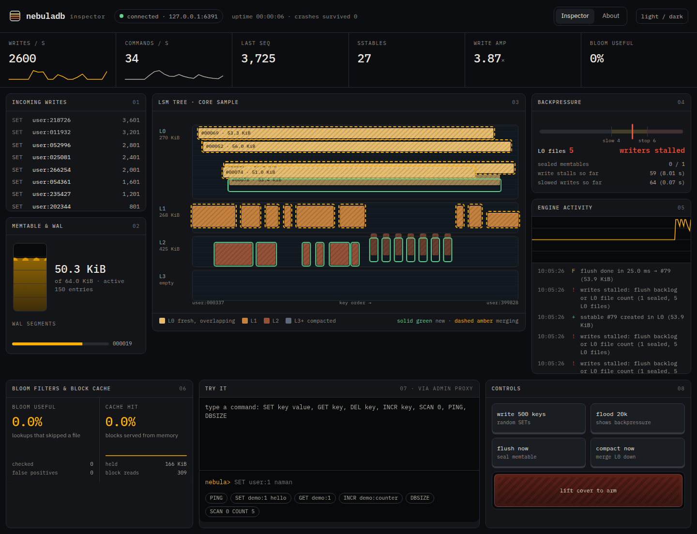
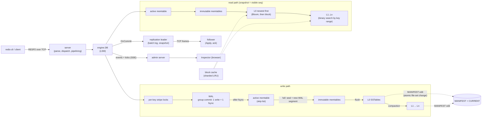
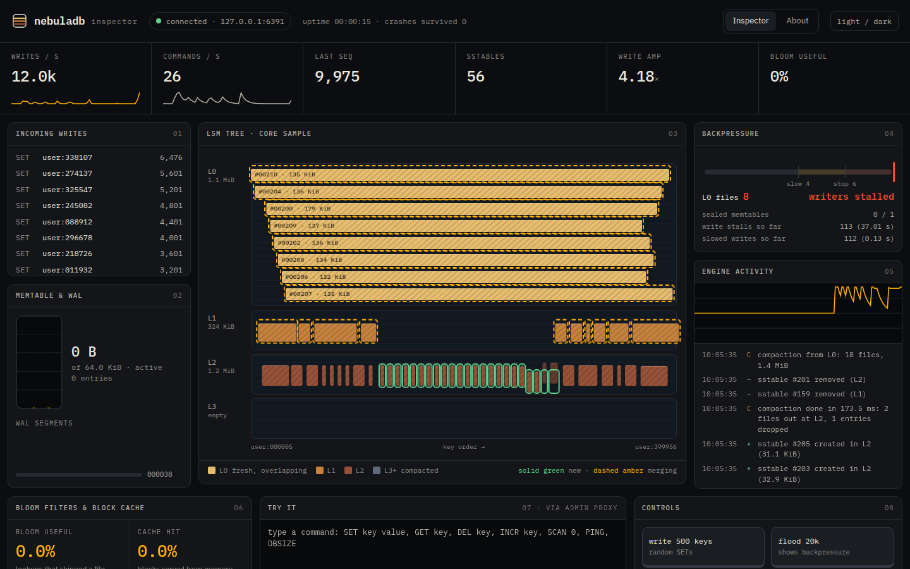
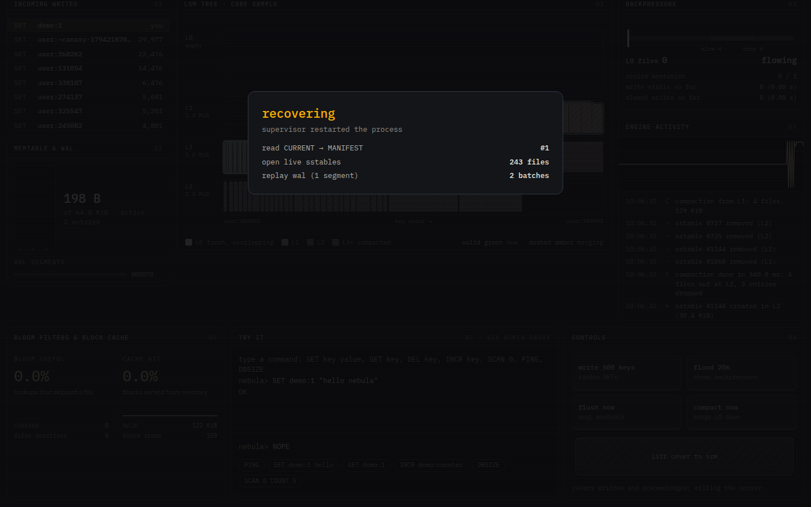
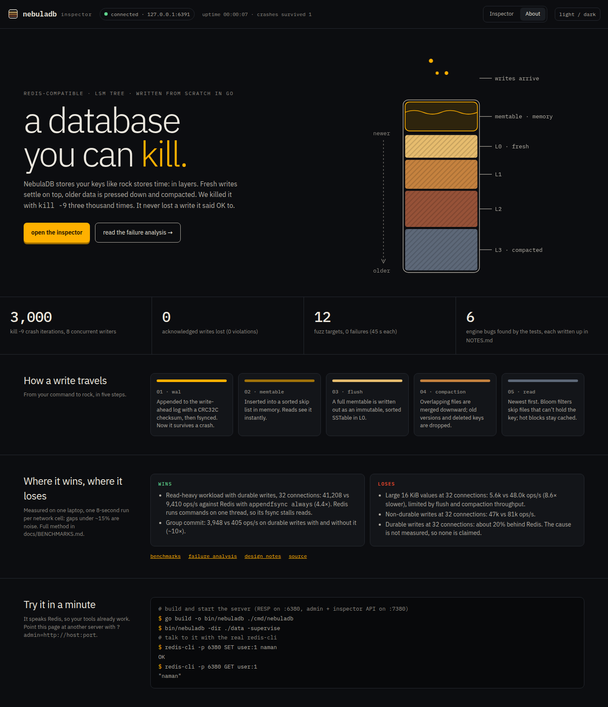
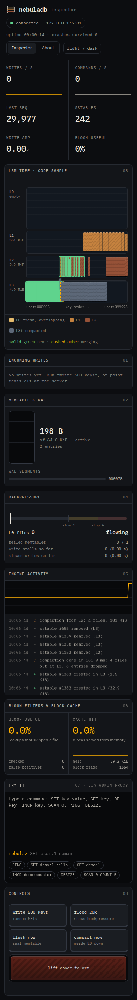

# NebulaDB

**A crash-safe, Redis-compatible key-value database with an LSM-tree storage engine, written from scratch in Go.**

You can point `redis-cli` or a Redis client library at it. Underneath, every layer is this repository's own code: the wire protocol parser, the write-ahead log with group commit, the skip-list memtable, the SSTable format with Bloom filters, the block cache, two compaction strategies, the MANIFEST that makes file-set changes atomic, recovery, backpressure, replication, and a live web Inspector. The only third-party code in the repository is in the benchmark module (Pebble and BadgerDB as comparison targets) and in the Inspector's build tooling.

It was built to be *studied*: [docs/LEARN.md](docs/LEARN.md) is a guided reading tour, [docs/FAILURES.md](docs/FAILURES.md) walks through what a crash does at every step, and [docs/INTERVIEW.md](docs/INTERVIEW.md) has 50 questions with answers taken from this code.



## What it is, and what it is not

| It is | It is not |
|---|---|
| RESP2 server: strings, TTLs, `SCAN`, `MSET/MGET`, `INCR` family, `INFO` | A full Redis: no lists, hashes, sets, sorted sets, pub/sub, transactions, scripting, clustering |
| Durable by default (`fsync=always`, group commit): an acknowledged write survives `kill -9` and power loss | Audited for production use. It is a learning and portfolio project |
| Tested by killing it: 3,000 real `SIGKILL` iterations, a fault-injecting filesystem, fuzzing | A claim to be faster than Redis, Pebble or Badger in general. See the benchmarks for exactly where it wins and loses |
| Leader/follower replication, read-only replicas, optional synchronous acks | Highly available: failover is manual, there is no consensus (no Raft) |
| An embedded Go library as well as a server (`pkg/nebuladb`) | Multi-key transactions beyond atomic `MSET` |

## Architecture



Where each box lives: `internal/server` (RESP commands), `internal/resp`, `internal/engine` (DB, flush, compaction, snapshots), `internal/wal`, `internal/memtable`, `internal/sstable`, `internal/bloom`, `internal/cache`, `internal/manifest`, `internal/iterator` (merge + visibility), `internal/vfs` (all file I/O, with a fault-injecting implementation), `internal/repl`, `internal/admin`, `inspector/` (React UI). The reading order is in [docs/LEARN.md](docs/LEARN.md).

## On-disk formats

Everything is little endian and checksummed (CRC32C). Full details and the reasoning are in [NOTES.md](NOTES.md).

```
WAL segment  NNNNNN.wal
  record   = len u32 | crc32c(payload) u32 | payload
  payload  = seq u64 | count u32 | count x op
  op       = type u8 (1 put, 2 delete) | keyLen u32 | valLen u32 | expireAt i64 | key | value
  one record = one atomic batch (MSET is one record)

SSTable  NNNNNN.sst
  data blocks* | filter block (Bloom over user keys) | index block | properties | footer(64 B, magic "NEBULSST")
  block   = prefix-compressed entries + restart points | compression u8 | crc32c u32
  index   = one entry per data block (sparse): last key of the block -> offset, size

MANIFEST-NNNNNN + CURRENT
  log of edits (add file / delete file / next file number / last seq / WAL boundary), each CRC32C-framed
  CURRENT names the live MANIFEST and is replaced atomically (tmp + fsync + rename + directory fsync)
```

## Guarantees, per fsync mode

| `-fsync` | process crash (`kill -9`, OOM, panic) | power loss / kernel crash |
|---|---|---|
| `always` (default) | no acknowledged write lost | no acknowledged write lost (concurrent writers share one fsync) |
| `every` (`-fsync-interval`) | no acknowledged write lost | up to one interval of acknowledged writes may be lost; the log stays a clean prefix |
| `never` | no acknowledged write lost | unbounded loss possible, still a clean prefix; never garbage |

Also: multi-key `MSET` is all-or-nothing across a crash; a write is visible to readers only after it is durable; after a failed `fsync` the WAL refuses further writes until restart (retrying `fsync` can falsely succeed); a bad record is a torn tail only if nothing valid follows it, otherwise recovery refuses to start instead of silently dropping data. Replication guarantees are separate and spelled out in [NOTES.md](NOTES.md#replication-phase-13-leaderfollower-by-logical-wal-shipping).

## Commands

`PING ECHO GET SET (EX PX NX XX KEEPTTL) DEL EXISTS EXPIRE PEXPIRE TTL PTTL PERSIST MGET MSET INCR DECR INCRBY DECRBY SCAN (MATCH COUNT) DBSIZE INFO FLUSHDB FLUSHALL`, plus `COMMAND`, `SELECT 0`, `HELLO 2`, `CLIENT SETNAME/SETINFO/ID` so client libraries connect. `HELLO 3` is answered `NOPROTO` like Redis, so clients fall back to RESP2. `DBSIZE` is approximate by design (an LSM cannot count without merging every level).

## Run it

```sh
go build -o bin/nebuladb ./cmd/nebuladb
go build -o bin/nebula   ./cmd/nebula
bin/nebuladb -dir ./data -supervise          # RESP :6380, admin/Inspector API :7380
redis-cli -p 6380 SET user:1 naman
redis-cli -p 6380 GET user:1
cd inspector && npm install && npm run dev   # Inspector at http://127.0.0.1:5173
```

Docker, release archives, systemd and replication setup: [docs/INSTALL.md](docs/INSTALL.md). Common targets: `make build test race fuzz crash model bench repl release docker` (`make` itself may need installing; every target is a plain `go` or script command).

## How it was tested (all numbers from real runs on one machine: i7-1165G7, 8 threads, Linux under WSL2, Go 1.27.3)

| Test | What it does | Result |
|---|---|---|
| **Crash campaign** (`tests/crash`) | Real server binary, 8 concurrent writers, `SIGKILL` at random moments and aimed at flushes, compactions and WAL rotations; after each restart every key is checked against a model of what was acknowledged | **3,000 kill/restart iterations, 0 violations.** 374 kills landed during a flush, 829 during a compaction; 4,584,446 acknowledged operations; 1,320,440 key verifications |
| **Fault injection** (`tests/fault`) | A filesystem wrapper that fails or tears writes, fails `fsync`/`rename`, fills the disk, flips bits on read, and simulates power loss by dropping un-synced data | Disk-full at 27 sizes, `fsync` failures on WAL/SSTable/MANIFEST/directory, short writes at every length 0 to 70, **500 random bit flips in SSTables/MANIFEST: 181 refused at open, 319 caught on read, 0 silently wrong answers**, 30 seeded chaos runs against an exact model |
| **Model tests** (`tests/model`) | 8 seeds x 3,000 engine operations and 8 seeds of pipelined RESP batches, compared with a model of Redis semantics, both compaction styles | pass |
| **Fuzzing** (`scripts/fuzz.sh`) | 12 fuzz targets: RESP, WAL, SSTable, MANIFEST, Bloom, glob, and opening an engine over garbage files; 45 s each | 0 failures |
| **Replication** (`tests/repl`) | Real leader and follower processes, `SIGKILL` of either | sync mode: 69,513 acknowledged writes over 6 leader kills, 0 missing on the replica and after promoting it |
| **Bugs found by the tests** | | 6 real engine/tooling bugs, each written up with its cause and regression test in [NOTES.md](NOTES.md#bugs-found-by-tests) |

Honest limits: `SIGKILL` does not drop the OS page cache, so the 3,000-iteration campaign proves *process*-crash consistency; power loss is covered by the fault-injecting filesystem, not by pulling a real plug.

## Benchmarks (full method, caveats and raw data: [docs/BENCHMARKS.md](docs/BENCHMARKS.md))

Same machine as above; the disk's `fsync` costs about 2.4 ms (p50), which dominates every durable-write number. Network cells are single 8 s runs: **treat gaps under about 15 to 20% as a tie.** Redis 8.10.3 was run natively (Docker Desktop's port proxy halved its throughput).

**Network, 32 connections, ops/s**

| workload | NebulaDB | Redis |
|---|---|---|
| durable writes (`fsync always` vs AOF `always`) | 3,948 (405 without group commit) | 4,797 |
| 95% reads + 5% durable writes | **41,208** | 9,410 (4.4x) |
| writes, relaxed durability (`every` vs AOF `everysec`) | 47,627 | 54,516 |
| writes, no persistence (`never` vs none) | 46,941 | 81,461 |
| large 16 KiB values, writes | 5,586 | 48,010 |

**Embedded, 16 goroutines, median of 3 runs, ops/s**

| workload | NebulaDB | Pebble v2 | BadgerDB v4 |
|---|---|---|---|
| durable writes | 2,379 | 2,473 | 627 |
| reads (memory-resident) | 1,461,317 | 885,150 | 316,731 |
| writes, no fsync | 126,480 | 437,050 | 82,550 |
| scan, 100 keys | 63,329 | 203,387 | 80,790 |

**Amplification** (300,000 keys, 2,000,000 random overwrites): leveled write amplification 5.07 and space amplification 1.64; size-tiered 3.92 and 2.74 (the textbook trade, measured). Pebble: 4.51 and 1.57.

Where it wins: durable reads when writes share the server (Redis runs commands on one thread, so its inline `fsync` stalls every read), and group commit (about 10x over per-write `fsync`). Where it loses: large values (flush and compaction throughput limit, 8.6x slower than Redis here), non-durable writes (about 3x slower than Pebble embedded), scans. [docs/BENCHMARKS.md](docs/BENCHMARKS.md) explains each with the evidence. Charts: [docs/charts/](docs/charts/) (SVG, light and dark).

## The Inspector

A live view of the engine, driven by the admin server's event stream: incoming writes, the memtable filling and sealing, SSTables as a core sample (placed by key range, sized by bytes; new tables ringed green, tables being merged dashed amber), backpressure, a seismograph of engine activity, Bloom filter and cache efficiency, a command terminal, and a guarded **crash switch** that writes a canary key, `SIGKILL`s the server, and then shows the recovery the restarted process reports, ending with a read-back of the canary. Design notes: [NOTES.md](NOTES.md#design-system-strata); source: [inspector/](inspector/).

| | |
|---|---|
|  |  |
| Writers stalled: L0 reached the stop limit | `kill -9` recovery, steps reported by the restarted server |
|  |  |
| About page | 390 px layout (strata first) |

## Limitations (read these before relying on it)

* Not audited or battle-tested; one developer, one machine's worth of benchmarks, no long soak test.
* Power-loss behaviour is simulated by a fault-injecting filesystem, not observed on hardware.
* Replication is manual-failover only, asynchronous by default; there is no consensus and nothing prevents two writable leaders.
* A single flusher and a single compactor thread: sustained large-value writes are bounded by them (see the benchmark analysis).
* All live SSTables keep a file descriptor open (no descriptor cache yet).
* `SCAN` cursors map to resume keys through a bounded table (4,096 entries); an evicted cursor returns an error.
* Windows binaries compile but the directory lock and `-supervise` are Unix-only.
* No TLS and no authentication on either port: bind to loopback or a private network.

## Repository map

`cmd/` server and CLI, `internal/` all engine code, `pkg/nebuladb` embedded API, `tests/` crash, fault, model, replication and benchmark harnesses, `inspector/` web UI, `design/` design reference, `docs/` failure analysis, benchmarks, install, learning material, `NOTES.md` architecture, decisions, formats, results and bugs, `PROJECT_BRIEF.md` the original brief.
